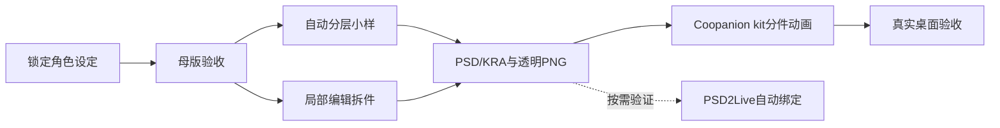

# Coopanion Skin Design

原创 Q 版人物桌宠绘制工程。目标平台为 **Coopanion**，采用官方分件动画方式；Cortico 是其 Agent 框架。

当前阶段：**锁定 v005，r03 原生行为小样已补左右腿跳跃收放，继承三档眨眼、轻微头动和独立坐姿/睡眠；全动作绑定尚未完成**。`npm run preview` 后打开 `/preview/dragon-r03.html` 查看最新动作小样；可暂停定位跳跃帧。静态原位合成差异为 0，跳跃/小跳已回看 48 张抽样帧；完整步态和实际客户端导入尚未测试。

官方鲸鱼娘已按固定版本采样为本地逐帧参考库，见 [采样规格与使用方式](docs/OFFICIAL_FRAME_REFERENCE.md)。新素材的唯一基准见 [production-lock.json](characters/original-01/production-lock.json)，问题原因见 [失败复盘](docs/RIG_FAILURE_REVIEW.md)。

推荐生产线：角色设定 → 单张母版 → See-Through 分层试验 → 局部补画与分层精修 → 统一 PNG 部件 → Coopanion kit / rig → 桌面验收。
若自动分层质量不达标，直接采用官方「局部编辑 + 配准 + 遮罩拆件」路线；不反复重跑整张图。

## 从这里开始

- [绘制工程与阶段验收](docs/PRODUCTION_PLAN.md)
- [工具与 Skill 选型、实测状态](docs/TOOLS.md)
- [官方依据与版本记录](docs/SOURCES.md)
- [母版、拆件、局部修补提示词](prompts/production.md)
- [首个角色设定单](characters/original-01/brief.json)
- [分件映射表](characters/original-01/parts.csv)
- [制作与返工记录](characters/original-01/jobs.csv)



本仓库目前交付生产工程、v005 原位分层源文件和 r03 动作开发包。失败的 `packs/gpt-dragon` 仅留本机排查，不是可交付皮肤。PSD2Live 的 `.moc3` 不能当成 Coopanion 的 `figure.json` 包直接导入。

## 本机检查

在仓库根目录执行 `python scripts/doctor.py`，查看命令与当前 Python 的图像依赖。找不到 GUI 程序只表示 PATH 未发现，不代表机器上一定没安装。

图像处理依赖待进入拆件阶段后装入独立环境：

```powershell
python -m venv .venv
.\.venv\Scripts\python -m pip install -r requirements-art.txt
.\.venv\Scripts\python scripts/doctor.py
```

依赖范围是选型约束，尚非经过安装验证的锁文件。首轮工具实测通过后再冻结精确版本。

最新腿部修正、参数入口和限制见 [r03 记录](characters/original-01/rig-v005-r03/README.md)。
